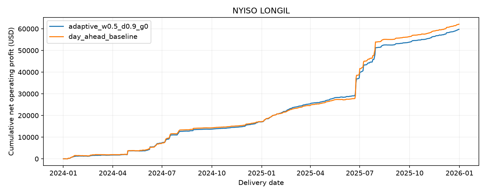

# NYISO LONGIL: 2024-01-01 through 2025-12-31

Selected model: `adaptive_w0.5_d0.9_g0`. Prices and profits are USD.

| Metric | Strategy | Day-ahead forecast baseline |
| --- | ---: | ---: |
| Net operating profit | 59,744.77 | 62,119.90 |
| Daily P&L Sharpe | 5.41 | 4.34 |
| Maximum daily drawdown | 172.82 | 197.91 |
| Active days | 718.00 | 717.00 |

Profit improvement: -3.82%.

Detailed CSVs: [daily P&L](ledgers/daily.csv) and [hourly dispatch](ledgers/hourly.csv).

Both models use identical batteries, costs and cycle limits. Plans use published day-ahead prices as a forecast; settlement uses realized hourly RT prices. The strategy updates from five-minute observations at least ten minutes old. Final historical revisions are not publication-vintage data. Zonal prices proxy actual nodal storage settlement.

Profits exclude capital costs, fixed operating expenses, financing and taxes. Sharpe describes simulated operating P&L, rather than investment returns. Square-root annualization does not correct for serial dependence. Idle days are included. Each day physically starts and finishes empty.
